<!--
  Perfil escrito como una pequeña API: cada tarjeta es la "respuesta" a una
  petición (GET /me, OPTIONS /stack…). Los SVG se generan con los scripts de
  scripts/ a partir de datos/perfil.json y GitHub Actions los regenera a diario.
  El bloque HTML va sin líneas en blanco para que no aparezcan huecos entre
  tarjetas.
-->

<picture><source media="(prefers-color-scheme: dark)" srcset="assets/banner-dark.svg"></picture>
<a href="mailto:pablotl.dev@gmail.com"><picture><source media="(prefers-color-scheme: dark)" srcset="assets/contacto-email-dark.svg"></picture></a><a href="https://www.linkedin.com/in/pablo-torrecilla/"><picture><source media="(prefers-color-scheme: dark)" srcset="assets/contacto-linkedin-dark.svg"></picture></a>
<picture><source media="(prefers-color-scheme: dark)" srcset="assets/sobre-mi-dark.svg"></picture>
<a href="https://github.com/Jhonttt/proyecto-intermodular"><picture><source media="(prefers-color-scheme: dark)" srcset="assets/destacado-dark.svg"></picture></a>
<picture><source media="(prefers-color-scheme: dark)" srcset="assets/trayectoria-dark.svg"></picture>
<picture><source media="(prefers-color-scheme: dark)" srcset="assets/stack-dark.svg"></picture>
<picture><source media="(prefers-color-scheme: dark)" srcset="assets/actividad-dark.svg"></picture>
 SVG generados a partir de <a href="datos/perfil.json"><code>datos/perfil.json</code></a> · datos de actividad renovados cada hora con GitHub Actions

